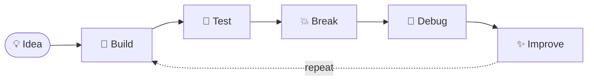

<!-- Header banner -->
<div align="center">


<a href="https://github.com/brizziehx">
  
</a>

<br><br>

<a href="https://github.com/brizziehx"></a>


</div>

---

## 👨‍💻 About Me

```text
brighton@dev:~$ whoami
Brighton
│
├── 🧠 Thinks in systems
├── ⚙️  Builds with code
├── 🔐 Cares about security
├── ☁️  Lives somewhere between cloud & localhost
├── 🤖 Curious about intelligent systems
└── 🚀 Always shipping
```

> 💡 **Don't just use the technology. Understand it.**
> I like knowing what's happening *under the hood*: from the API request to the database, from the container to the server, from the abstraction to the machine.

---

## ⚡ Tech Stack

<div align="center">


</div>

<br>

<div align="center">

| 🔧 Backend | 🎨 Frontend | ☁️ Infrastructure | 🗄️ Data |
| :---: | :---: | :---: | :---: |
| Spring Boot | React | Docker | PostgreSQL |
| Django | Next.js | AWS | Redis |
| FastAPI | Flutter | Linux | REST APIs |

</div>

---

## 🌐 Languages

<div align="center">


</div>

---

## 🧬 Engineering DNA

<div align="center">



</div>

---

## 🖥️ Terminal

```bash
$ cat philosophy.txt

  Build things worth using.
  Understand what you build.
  Keep learning.
  Ship.
  Repeat.

$ echo $STATUS
building...
```

---

## 📊 GitHub Stats

<div align="center">


<br>


</div>

---

<div align="center">

### `CODE • CREATE • SHIP • REPEAT`

*If it can be imagined, it can probably be built.*


</div>
